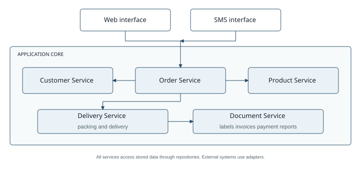

# EarlyBird Application Core Architecture

Version 1  Simple architecture

## Architecture proposal

I propose a layered application with five services. Web requests and SMS messages call the same Order Service, so both channels apply the same business rules. The services run in one application and store their data in one relational database.

| Component | Responsibility |
| --- | --- |
| Order Service | Build carts, copy a previous order, submit or cancel orders, and provide order status. |
| Customer Service | Authenticate users, check blacklist status, and provide the predefined address. |
| Product Service | Search products and provide codes, units, prices, characteristics, and package contents. |
| Delivery Service | Support packing, assign couriers, plan routes, and record dispatch and delivery. |
| Document Service | Create labels and numbered invoice copies, send payment records, and print the nightly report. |

Repositories load and save business data. Adapters connect the application to SMS, printing, route optimization, and the existing payment system. A package can contain quantities of simple products or other packages.

## Submitting and fulfilling an order

1. The web interface or SMS parser passes customer credentials, product codes, quantities, and an optional previous order reference to the Order Service.

2. The Customer Service verifies the customer and blacklist status, then returns the customer number and predefined delivery address. Invalid requests are rejected.

3. The Order Service copies an optional blueprint belonging to this customer and combines it with other selections. The Product Service validates all product codes and returns current prices.

4. The Order Service calculates the total and saves the order, its address, and its item prices. It assigns an order number with checksum. Only after saving succeeds does the interface return that number to the customer.

5. A packing clerk retrieves the order, assembles the products, and assigns a courier. The Document Service generates the label and two separately numbered invoice copies. Once assembly is complete, it sends customerNumber, orderNumber, amountInEuros, and expectedPaymentDate to the payment system.

6. The Delivery Service plans a route that can include several orders and accounts for the 25-minute delivery deadline. Departure changes the status to out for delivery. The customer confirms receipt with a password in the browser on the courier's smartphone.

Cancellation is possible until assembly is complete. It is permanent. Order contents cannot be edited after submission; a change requires cancellation and a new order. The nightly report lists the daily orders, their products and quantities, customer details, and assigned packing and delivery clerks.

## Changes for new requirements

**a Standing orders.** Add a Standing Order Service and a scheduler. Store the customer, items, and recurrence. Each Sunday, for example, the scheduler creates an ordinary order through the Order Service, which rechecks eligibility and current prices. Packing and delivery are reused.

**b All meals all day.** Extend the Product Service with meal categories and availability times. Adapt operating-hour rules in ordering and delivery. Generic products and orders already support meals beyond breakfast.

**c Online tracking.** Extend the Delivery Service with a customer-authorized tracking query and add a web tracking page. Reuse stored dispatch and delivery status. Live vehicle tracking would additionally require courier location updates.
