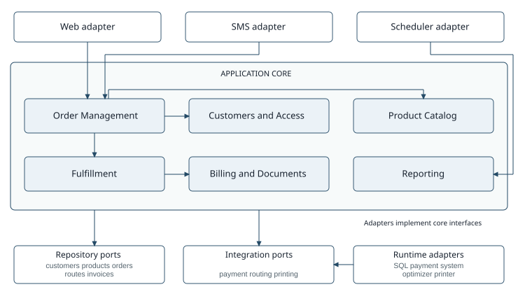

# EarlyBird Application Core Architecture

Version 2  Standard architecture

## Architecture decision

I propose a modular monolith using ports and adapters. The application core contains six business modules. Web, SMS, scheduled jobs, storage, and external systems connect through explicit interfaces. Keeping the modules in one process allows order state changes to use straightforward database transactions.

The arrows show the principal interactions. Order Management validates customers and products before accepting an order, then makes accepted work available to Fulfillment. This handoff is a stored order retrieved by the packing workflow, not immediate packing during submission. The web adapter also exposes catalog search and staff workflows; these secondary entry points are omitted for readability.

Repository and integration interfaces belong to the core. Adapters implement them. Therefore, a change to the SMS gateway, database driver, route optimizer, or printer does not require changes to the order rules.

Scope: application logic for customers, packing clerks, delivery clerks, and managers. Phone-clerk workflows are replaced by the web application and SMS interfaces. [R32-R36]

## Components and domain rules

| Module | Owned responsibilities |
| --- | --- |
| Customers and Access | Authentication, employee roles, customer-number validation, blacklist checks, and the predefined delivery address. |
| Product Catalog | Product search by characteristics, unique product codes, units, euro prices, and nested package definitions. Public search requires no login. |
| Order Management | Carts, at most one blueprint per order, price calculation, order-number generation, submission, cancellation, and status queries. |
| Fulfillment | Packing work, packing and delivery clerk assignment, route planning for multiple orders, dispatch, and customer delivery confirmation. |
| Billing and Documents | Labels, invoices, distinct invoice-copy numbers, expected-payment records, and document output. |
| Reporting | Daily order and fulfillment queries and automatic nightly report generation and printing. |

The Product model uses a Composite structure: a SimpleProduct is a leaf; a ProductPackage contains quantities of other products. Packages may be nested, but their definitions must not contain cycles. Each ordered product keeps its own catalog price; a package price is not assumed to equal the sum of its components.

An Order belongs to exactly one customer and contains OrderLines with positive quantities. It records at most one blueprintOrderId; one old order can be reused as a blueprint many times. A blueprint provides item selections, while the new order receives its own identifier, timestamps, and current prices. [R4-R6, R10, R13-R17]

Order contents and the price and address snapshots are fixed after submission. Assembly completion and cancellation compete for the same submitted state and must update it atomically. The losing operation is rejected. Cancellation cannot be undone. [R28-R31]

## Order submission sequence

1. The adapter creates SubmitOrder with authentication context, selected product codes and quantities, an optional blueprintOrderId, and a request identifier.

2. Customers and Access authenticates the customer, checks blacklist status, and returns the customer number and predefined address. Order Management checks ownership before copying any blueprint.

3. Product Catalog resolves all selected codes and returns names, units, current prices, and composition data. Order Management checks quantities and calculates the total using authoritative catalog data.

4. Order Management creates the submitted order, generates its number with checksum, and persists the order lines, address and price snapshots, timestamps, and request identifier in one transaction.

5. After commit, the adapter returns the order number to the customer. The SMS adapter sends the required confirmation text. Repeating the same request identifier returns the existing result rather than creating another order.

Invalid credentials, a blacklist entry, an invalid product, or an inaccessible blueprint prevents acceptance. A database failure produces no success confirmation. Search is available before authentication; checkout and order-history access require authentication.

## Packing delivery and payment

A packing clerk obtains accepted orders from Fulfillment, assembles their products, and assigns a delivery clerk. Billing and Documents generates a label containing both clerks, customer name and address, and order number. The invoice adds the ordered products, quantities, prices, and total. Each printed invoice copy receives a separate number. [R18-R23]

CompleteAssembly changes the order to ASSEMBLED and records a pending expected-payment transfer in the same transaction. A payment adapter sends customerNumber, orderNumber, amountInEuros, and expectedPaymentDate to the existing payment system. A pending record can be retried after an integration failure; payment registration is never triggered at checkout. [R42-R43]

Fulfillment passes addresses, assigned courier, and delivery deadlines to a route optimizer. A route can contain several orders. The clerk prints the itinerary and marks the route as departed, changing its orders to OUT_FOR_DELIVERY. The 25-minute deadline is measured from order acceptance and guides packing priority and route planning. [R1, R24-R25]

At the door, the courier presents a browser on a smartphone. Customers and Access verifies the customer's password for that order, and Fulfillment records delivery confirmation and its timestamp. Passwords are not stored with the order. The nightly reporting job prints each day's orders with the required product, quantity, employee, customer, address, and order data. [R35, R44]

## Changes for new requirements

**a Standing orders.** Add Standing Order Management, a recurrence repository, and a scheduler. A definition stores the customer, product quantities, recurrence, time zone, and active status. Each due occurrence calls the ordinary order-submission use case with a unique occurrence key, revalidating eligibility and prices. Billing and Fulfillment continue processing individual orders.

**b All meals all day.** Extend Product Catalog with meal categories and time-based availability. Adapt ordering and delivery operating-hour policies. Existing product packages, orders, invoices, and payment records remain generic. The delivery guarantee remains unchanged unless separately revised.

**c Online tracking.** Add a customer-authorized tracking query to Fulfillment and a web tracking view. Publish assembly, departure, and delivery timestamps from existing lifecycle transitions. If live map tracking is required, add courier position updates, location storage, and a map adapter.

Source: Melanie Goldblum, Early Bird Management System (EBMS), Requirements Version 1.50, pages 1 to 3. Requirement references use R followed by the requirement number.
