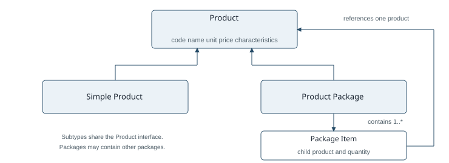
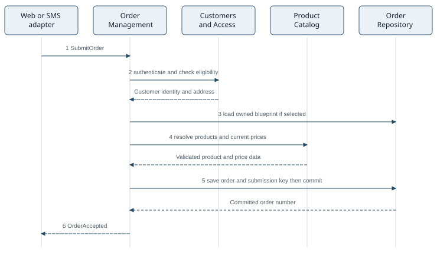
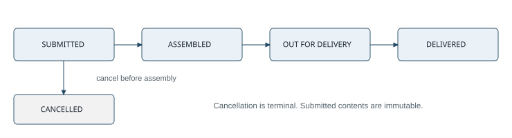

# EarlyBird Application Core Architecture

Version 3  Detailed architecture

## Architecture decision and scope

I propose a modular monolith with ports and adapters. Six modules separate ordering, customer access, products, fulfillment, billing, and reporting. The core owns business rules and interface contracts. Technology adapters handle web and SMS transport, persistence, printing, route optimization, and the existing payment system.

A single deployable application is appropriate because accepting, cancelling, and assembling orders require consistent state changes. Module boundaries allow features to evolve independently without introducing distributed transactions into the initial system.

Order Management consults Customers and Access and Product Catalog, then persists accepted orders. Fulfillment retrieves these orders for packing and coordinates assembly, documents, routes, and delivery. The Order Management to Fulfillment arrow represents the handoff of accepted work through storage. Reporting is invoked by the nightly scheduler.

Every adapter calls an application use case. Repositories and external integrations implement interfaces defined by the core; domain objects do not call web frameworks, SQL clients, printers, or SMS providers. The shared core applies the same rules to orders arriving through either channel.

The design automates the stated future business processes. Employee web workflows and public catalog search also use the core; secondary adapter-to-module connections are omitted from the diagram for readability. [R32-R44]

## Module responsibilities and contracts

| Module | Responsibilities and principal operations |
| --- | --- |
| Customers and Access | AuthenticateCustomer; AuthorizeEmployee; CheckCustomerEligibility; GetDeliveryAddress. Owns customer identity, predefined address, blacklist status, and access rules. |
| Product Catalog | SearchProducts; ResolveProducts; ExpandPackage. Owns unique codes, units, euro prices, searchable characteristics, and acyclic package composition. |
| Order Management | BuildCart; SubmitOrder; CancelOrder; GetOrderStatus. Owns Order, OrderLine, blueprint links, totals, immutable submission data, and legal state transitions. |
| Fulfillment | GetPackingWork; AssignClerks; CompleteAssembly; PlanRoute; DispatchRoute; ConfirmDelivery. Owns packing assignments, delivery routes, stops, and confirmation records. |
| Billing and Documents | CreateLabel; CreateInvoice; PrintInvoiceCopy; RegisterExpectedPayment. Owns invoice data, copy numbering, and the pending payment transfer. |
| Reporting | BuildDailyReport; PrintDailyReport. Queries stored order and fulfillment information and produces the required nightly output. |

### Interfaces at the boundary

Repositories provide customer, catalog, order, route, invoice, and pending-transfer storage. A UnitOfWork interface commits related updates atomically. PaymentGateway accepts the four required payment fields. RouteOptimizer accepts delivery stops and deadlines and returns an ordered itinerary. DocumentPrinter accepts a generated label, invoice copy, itinerary, or daily report.

### Access control

Customers can search publicly and manage only their own orders after authentication. Packing clerks access packing and assembly actions; delivery clerks access their routes and delivery workflow; managers access business reports. The core checks these permissions for each use case, including SMS requests and internal scheduled commands.

Delivery confirmation verifies the customer's credentials on the delivery device for the selected order. It does not change the courier's identity or store the customer password in the delivery record. [R34-R36]

## Domain model and invariants

Product defines productCode, name, unit, priceInEuros, and searchable characteristics. A SimpleProduct is a leaf. A ProductPackage owns one or more PackageItems, each referencing a product and a positive quantity. Package definitions must be acyclic. Expansion produces a packing list; the commercial order line retains the package's own price and description. [R2-R6, R12, R38]

| Entity | Essential data and constraints |
| --- | --- |
| Customer | Customer number, name, one predefined address, blacklist state, and credential reference. Number validation uses two area digits, seven identifier digits, and one checksum digit. |
| Order | Order number, customerId, submittedAt, deadline, state, delivery-address snapshot, total, optional blueprintOrderId, and submission key. Exactly one customer per order. |
| OrderLine | Product reference, description, unit, positive quantity, unit-price snapshot, line total, and composition version or packing snapshot. |
| DeliveryRoute | Assigned delivery clerk, ordered stops, linked order numbers, planned itinerary, and actual departure time. One route may fulfill several orders. |
| Invoice and copy | Invoice references the order and its line data. Every printed copy has its own copy number. Employee assignments are retained for documents and reports. |

An order has zero or one blueprint, while an existing order can be referenced by many follow-up orders. Copying is allowed only from the customer's own history. The blueprint supplies selections; the new order uses current validated products and prices. Product or address changes after submission do not rewrite accepted orders. [R10, R13-R17]

## Order submission and exchanged data

**1 Receive.** The web adapter translates checkout data into SubmitOrder. The SMS adapter parses the defined C, W, and P fields into the same command. The command contains the authenticated principal or supplied credentials, product codes and quantities, optional blueprintOrderId, and a request key. Client-supplied totals are not authoritative. [R37-R40]

**2 Authenticate.** Customers and Access checks credentials, customer-number validity, and blacklist state. It returns customerId, customerNumber, name, and the predefined address. Failure stops processing before any order is committed. [R8-R11, R17]

**3 Resolve selections.** Order Management loads an optional owned blueprint, merges its selections with direct and searched selections, and enforces the maximum of one blueprint. Product Catalog returns current product codes, units, descriptions, prices, and composition data.

**4 Commit.** Order Management validates positive quantities, calculates line totals and the total, captures immutable data, and assigns a unique order number with checksum. The order, its lines, submission timestamp, deadline, and request key are saved in one transaction.

**5 Respond.** Only after commit does Order Management return OrderAccepted with orderNumber, status, and total. The web interface displays the result; the SMS adapter replies with the assigned order number. Packing and payment registration are later workflow steps.

## Fulfillment documents and delivery

1. A packing clerk requests the accepted work list. Fulfillment returns order numbers, ordered items, quantities, and package composition. The clerk assembles the bag and assigns a delivery clerk.

2. CompleteAssembly verifies that the order is still submitted. One transaction records ASSEMBLED, assembly time, employee assignments, the invoice data, and a pending expected-payment transfer. Its successful commit establishes the cancellation boundary.

3. Billing and Documents produces the bag label and two invoice copies. The label contains packing clerk, customer first name and surname, address, order number, and assigned delivery clerk. The invoice adds commercial product lines, quantities, prices, and total. Every printed copy, including reprints, receives its own number. [R19-R23]

4. The payment adapter sends customerNumber, orderNumber, amountInEuros, and expectedPaymentDate from the committed pending record. An interface record is due only after assembly. The expected date is calculated by a configurable payment-terms policy. [R42-R43]

5. Fulfillment sends order numbers, delivery addresses, deadlines, and courier assignment to RouteOptimizer. The result is an ordered set of stops for a route containing one or more orders. The itinerary is printed, and the courier takes the matching bags and invoices. [R24-R25, R32]

6. DispatchRoute records the actual departure and changes the linked orders to OUT_FOR_DELIVERY. Status queries now report that the courier is on the way. At each stop, the customer enters a password on the courier's browser; successful verification records DELIVERED and the confirmation time. [R27, R35]

CancelOrder succeeds only while the order is SUBMITTED. Cancellation is terminal. No command edits accepted order contents; a customer must cancel and submit a new order. A packing workflow in progress must handle cancellation until assembly completes. [R28-R31]

## Consistency failure handling and operation

### Transactions and retries

Amounts use decimal euro values with an explicit rounding rule. Dedicated policies generate identities and checksums. Database uniqueness constraints protect product codes, order numbers, and submission keys.

Submission uses a unique request key and one transaction. A retry after a lost response returns the previously committed order. A failed commit cannot produce an accepted order response. Blueprint loading, price validation, and snapshot creation use a consistent catalog version or a final version check before commit.

Cancellation and CompleteAssembly use an order version or conditional update from SUBMITTED. Exactly one transition can succeed. Dispatch must reject an order that has not been assembled, and delivery confirmation must match the order's customer and assigned delivery workflow.

Assembly completion and its pending payment record are committed together. A background worker retries unsent records and retains their delivery state. The worker uses orderNumber as a stable external reference. Deduplication or reconciliation with the payment system is required because a timeout after external acceptance can otherwise lead to a duplicate record; the specification does not promise an idempotent payment interface.

Printing reads committed document data. A failed print is retried without changing the order or sending another payment record. Each new invoice print request allocates a distinct copy number. A failed SMS confirmation is retried separately and never recreates the accepted order.

### Delivery deadline and reporting

Order acceptance records submittedAt and a target before submittedAt plus 25 minutes. Fulfillment prioritizes work by the remaining time, and route planning considers the deadlines of all stops. Late-risk orders are visible to staff. Meeting the promise also depends on packing capacity, courier capacity, and travel time; software scheduling alone cannot guarantee physical delivery. [R1]

The nightly scheduler passes a business date to Reporting. A consistent query joins daily orders, commercial products and quantities, packing clerk, delivery clerk, customer name and address, and order number, then requests printing. The report uses retained order snapshots and recorded assignments. The date boundary, included order states, and rerun policy are configurable business decisions. [R44]

### Architectural tradeoffs

The single process and relational database simplify consistency and deployment. Modules still have separate interfaces and ownership; they do not read each other's private tables directly. Reporting uses an explicit read interface or maintained reporting view. A later move to separate services is possible, but it would require revisiting transaction and message-delivery guarantees.

## Impact of the three new requirements

### Standing orders

Add Standing Order Management, a recurrence repository, and a scheduler entry point. A standing order stores customerId, product codes and quantities, recurrence rule, local execution time, time zone, active period, and pause state. Each due occurrence creates one ordinary order through the shared application use case.

The scheduler runs as an authorized system actor and checks the customer's current eligibility; it does not retain the customer's password. An occurrence key composed of standingOrderId and scheduled time prevents duplicate orders. Each occurrence revalidates products and current prices, receives its own order number, and follows ordinary packing, cancellation, billing, and delivery.

Adapt the web adapter for creating, pausing, and changing recurrence definitions. Cancelling one generated order does not cancel future occurrences. Changes to the definition affect only future orders. A rule for unavailable items and a definition of execution time versus desired delivery time must be agreed.

### All meals throughout the day

Adapt Product Catalog to provide meal categories and availability intervals, and adapt operating-calendar policies used by ordering and fulfillment. Expand customer-facing terminology, search filters, and staff operating schedules. Keep product, package, order, invoice, and payment models generic.

No separate lunch or dinner order class is needed. Policies answer whether a product can be ordered at a particular time. The existing delivery promise continues unless the business explicitly revises it. New preparation or temperature rules would be separate requirements rather than assumptions about all meals.

### Customer delivery tracking

Expose a customer-authorized TrackingQuery from Fulfillment and add a web tracking page. Return orderNumber, lifecycle state, assembly time, dispatch time, delivery confirmation time, and an ETA if one is available. The customer can retrieve only their own order.

Existing lifecycle transitions already supply basic progress tracking. Polling can retrieve these changes without introducing a message broker. If a live vehicle map is required, add authenticated courier position updates, a Delivery Tracking component and location repository, a map adapter, and an ETA calculation policy. Limit location access to the relevant active delivery.

| Change | New or adapted core area | Reused workflow |
| --- | --- | --- |
| Standing orders | Recurrence module and scheduled submission entry point | Order validation, packing, invoices, payment, delivery |
| All day meals | Catalog availability and operating-calendar policies | Generic products, packages, orders, billing |
| Online tracking | Fulfillment queries and optional location tracking | Existing order states and dispatch confirmation |

## Requirement coverage and validation

| Requirements | Responsible design element |
| --- | --- |
| R1-R6 | Deadline policy; Product Catalog; recursive package composition; quantity, unit, and price data. |
| R7-R17 and R32 | Shared order use cases replace phone ordering; customer validation; public search; combined selections; one blueprint; predefined address and generated number. |
| R18-R23 | Fulfillment packing workflow; employee assignment; label and invoice generation; distinct invoice-copy numbering. |
| R24-R27 and R35 | Multi-order routes; optimizer and print ports; dispatch status; browser-based customer delivery confirmation. |
| R28-R31 and R41 | Atomic cancellation before assembly, irreversible cancellation, no order editing, and an SMS cancellation adapter. |
| R33-R34 and R36-R40 | Browser adapter and role checks; unauthenticated search; SMS parsing, unique product codes, and confirmation reply. |
| R42-R44 | Payment record after assembly and automatically printed nightly report. |

### Validation scenarios

The core must accept equivalent web and SMS selections as equivalent orders; calculate nested-package packing quantities; reject inaccessible blueprints; return an existing order for a repeated submission key; and preserve historical prices and addresses after catalog or customer changes.

Concurrency checks must show that cancellation and assembly cannot both succeed. Integration checks must show no payment record before assembly, safe retry or reconciliation after payment timeouts, distinct numbers on invoice reprints, and correct status after multi-order route dispatch. A delivery confirmation with another customer's password must fail.

### Open business decisions

The order-number rule requires clarification: R17 describes an eight-digit number with a checksum, while the R41 example contains nine digits. NumberFormatPolicy isolates the final choice. Payment terms are not defined, so expectedPaymentDate requires an agreed calculation rule.

The SMS cancellation example contains only an order number. Authentication of the sender, such as a verified registered phone number or another proof, must be specified before enabling cancellation. Browser versions in R33 are placeholders and must be supplied for compatibility validation.

R35 changes delivery confirmation to a browser-based password check. This design treats it as the future confirmation method while retaining the required invoice copies. The nightly reporting business-date boundary and handling of cancelled orders also require agreement.

Source: Melanie Goldblum, Early Bird Management System (EBMS), Requirements Version 1.50, pages 1 to 3. Requirement references use R followed by the requirement number.
