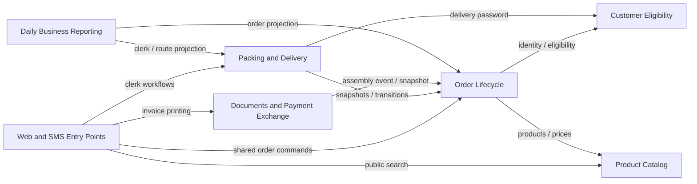

# EarlyBird: reviewed architecture proposal

The highest average silhouette selects k=2; its best run places 41 clauses together and isolates two product-search clauses. A seven-cluster candidate exposes more useful responsibilities and several mixed groups. The reviewed proposal assigns six application-core components and one channel boundary using source obligations, state ownership, and the three scenario walkthroughs. Its boundaries are human decisions, not a claim that the embedding model discovered this exact architecture.

This is a human-reviewed application-core design. The source-linked clauses remain the authority; numerical clustering metrics do not establish these ownership decisions.

Reviewed database run: `a983874ded32c47593dd23c6`, k=7, seed=0.

Inspect k=7 because it is the second-highest mean-silhouette candidate and separates recognizable cancellation, fulfillment, product, and reporting groups. Seed 0 has the highest silhouette within k=7. This is an explicit human selection for architectural inspection.

## Components and allowed use

Arrows identify allowed use or dependency on a producer's data contract. Event/data flow can run in the opposite direction. The existing payment processor, printers, and SMS gateway are external adapters; this is not a deployment diagram.

### Product Catalog

Scope: Application core.

Describe products, recursive breakfast packages, unit prices, and public product discovery.

Owns: Product definitions, package composition, units, prices, unique product codes, and search criteria.

Offers: FindProducts(criteria); ResolveProduct(code); DescribePackage(product); GetUnitPrice(product)

Primary clauses: R02.a, R04.a, R06.a, R12.a, R36.a, R38.a

### Customer Eligibility

Scope: Application core.

Identify customers, verify their identity and eligibility, and supply the predefined delivery address.

Owns: Customer identity, customer-number format, credentials, blacklist status, and the single predefined address.

Offers: AuthenticateCustomer(credentials); CheckEligibility(customer); GetDeliveryAddress(customer); VerifyDeliveryPassword(customer,password)

Primary clauses: R09.a, R11.a, R11.b, R17.a

### Order Lifecycle

Scope: Application core.

Create orders and blueprints and enforce the authoritative order state and cancellation rules.

Owns: Cart/order lines, one-customer ownership, blueprint links, order numbers, immutable submitted order snapshots, and lifecycle state.

Offers: PlaceOrder(request); CreateCartFromBlueprint(order); GetOrderStatus(number); TryCancelOrder(number); TryCompleteAssembly(number); RecordDispatchOrDelivery(number)

Primary clauses: R03.a, R05.a, R10.a, R11.c, R13.a, R14.a, R15.a, R16.a, R17.b, R27.a, R28.a, R29.a, R30.a, R31.a, R31.b

### Packing and Delivery

Scope: Application core.

Support packing, courier assignment, bag labels, multi-order itineraries, and authenticated delivery confirmation.

Owns: Packing work allocation, assigned delivery clerk, bag-label rendering, itinerary plans, and delivery-confirmation evidence. Order Lifecycle remains authoritative for lifecycle transitions.

Offers: GetPackingWork(order); AssignCourier(order,clerk); PrintBagLabel(order); PlanItinerary(orders); PrintItinerary(route); ConfirmDelivery(order,credentials)

Primary clauses: R18.a, R19.a, R19.b, R24.a, R25.a, R35.a

### Documents and Payment Exchange

Scope: Application core.

Produce separately numbered invoice copies and transfer expected-payment records on committed assembly completion.

Owns: Invoice-copy identity and rendering, expected-payment interface records, and transfer tracking. The existing payment processor remains external.

Offers: PrintInvoiceCopy(order); PrintInitialInvoicePair(order); RegisterExpectedPayment(assembledOrder); TransferExpectedPayment(record)

Primary clauses: R21.a, R22.a, R23.a, R42.a, R43.a

### Daily Business Reporting

Scope: Application core.

Assemble and print the manager's complete daily business report on the nightly schedule.

Owns: Reporting projection, report-day selection, schedule configuration, and report rendering/printing. Business-day policy remains unresolved.

Offers: BuildDailyReport(day); PrintNightlyReport(day)

Primary clauses: R44.a, R44.b

### Web and SMS Entry Points

Scope: Around the application core.

Translate web and SMS requests and responses into shared core operations.

Owns: Web forms, SMS C/W/P and O syntax, SMS transport limits, gateway integration, and channel response formatting.

Offers: HandleWebOrder(form); ParseSmsOrder(text); ParseSmsCancellation(text); SendOrderNumberSms(number)

Primary clauses: R32.a, R37.a, R39.a, R40.a, R41.a

## Decision log

### D01 · Choose an interpretable candidate rather than treating silhouette as a verdict

The k=2 reference isolates the two product-search clauses while placing the other 41 together. Its mean silhouette is 0.0698 and seed agreement is 0.1355. k=7 has mean silhouette 0.0620 and agreement 0.2686. The latter is more informative to inspect, but the low agreement prevents presenting its exact partition as established truth.

Evidence: R12.a, R36.a

### D02 · Split the identifiers/channel cluster by owned knowledge

Candidate cluster 4 mixes customer numbers/addresses, order numbers, product codes, channels, and payment-record fields. Assign these to Customer Eligibility, Order Lifecycle, Product Catalog, channel entry points, and Payment Exchange according to the business knowledge each owns. Shared identifier vocabulary is not a shared responsibility.

Evidence: R09.a, R17.a, R17.b, R32.a, R37.a, R38.a, R40.a, R42.a

### D03 · Keep one authoritative lifecycle across cancellation and assembly

Candidate cluster 0 contains cancellation rules while cluster 1 contains assembly/payment activity. Keep the order's authoritative state in Order Lifecycle. Packing reports completion through a guarded transition; Billing consumes the committed assembly trigger. The atomicity and reliable-transfer mechanism are engineering decisions derived from the source.

Evidence: R18.a, R28.a, R29.a, R30.a, R31.a, R43.a

### D04 · Separate print-copy behavior from the payment trigger

The candidate spreads invoices across clusters 1 and 5 and payment across 1 and 4. Group the financial document and exchange responsibilities with distinct operations: every print gets a new copy number, while only assembly completion triggers an expected-payment transfer. Co-location does not imply shared triggering.

Evidence: R21.a, R22.a, R23.a, R42.a, R43.a

### D05 · Keep blueprint rules with orders; return unrelated constraints to their owners

Candidate cluster 5 mixes blueprint reuse with unit pricing, invoice-copy numbers, and SMS limits. Keep blueprint links and their cardinalities in Order Lifecycle, unit pricing in Product Catalog, print-copy identity in Billing, and SMS limits at the channel edge.

Evidence: R06.a, R13.a, R14.a, R15.a, R16.a, R23.a, R39.a

### D06 · Distinguish public search from authenticated ordering and handover

Candidate cluster 6 groups access-related wording but includes three different workflows. Customer Eligibility verifies identity and blacklist status; Order Lifecycle assembles carts; Fulfillment owns delivery confirmation; Product Catalog permits public search. The shared word 'customer' does not force one component.

Evidence: R11.a, R11.b, R11.c, R35.a, R36.a

### D07 · Keep reporting together and make its reads explicit

Candidate cluster 3 already isolates nightly report scheduling and content. Preserve that responsibility. A reporting projection avoids making source modules depend on report layout, but projection freshness and the business-day cutoff require explicit policies.

Evidence: R44.a, R44.b

### D08 · Separate product definitions from customer selection and order lines

Candidate cluster 2 groups breakfast composition and discovery. Product Catalog owns package definitions and filtering. Order Lifecycle owns the customer's chosen items and quantities, preserving the distinction between a reusable product definition and an order instance.

Evidence: R02.a, R03.a, R04.a, R05.a, R12.a

## Complete ownership trail

| Clause | Database cluster | Reviewed primary owner |
|---|---|---|
| R02.a | C2 | Product Catalog |
| R03.a | C2 | Order Lifecycle |
| R04.a | C2 | Product Catalog |
| R05.a | C1 | Order Lifecycle |
| R06.a | C5 | Product Catalog |
| R09.a | C4 | Customer Eligibility |
| R10.a | C0 | Order Lifecycle |
| R11.a | C6 | Customer Eligibility |
| R11.b | C6 | Customer Eligibility |
| R11.c | C6 | Order Lifecycle |
| R12.a | C2 | Product Catalog |
| R13.a | C5 | Order Lifecycle |
| R14.a | C5 | Order Lifecycle |
| R15.a | C5 | Order Lifecycle |
| R16.a | C5 | Order Lifecycle |
| R17.a | C4 | Customer Eligibility |
| R17.b | C4 | Order Lifecycle |
| R18.a | C1 | Packing and Delivery |
| R19.a | C1 | Packing and Delivery |
| R19.b | C1 | Packing and Delivery |
| R21.a | C1 | Documents and Payment Exchange |
| R22.a | C1 | Documents and Payment Exchange |
| R23.a | C5 | Documents and Payment Exchange |
| R24.a | C1 | Packing and Delivery |
| R25.a | C1 | Packing and Delivery |
| R27.a | C1 | Order Lifecycle |
| R28.a | C0 | Order Lifecycle |
| R29.a | C0 | Order Lifecycle |
| R30.a | C0 | Order Lifecycle |
| R31.a | C0 | Order Lifecycle |
| R31.b | C0 | Order Lifecycle |
| R32.a | C4 | Web and SMS Entry Points |
| R35.a | C6 | Packing and Delivery |
| R36.a | C6 | Product Catalog |
| R37.a | C4 | Web and SMS Entry Points |
| R38.a | C4 | Product Catalog |
| R39.a | C5 | Web and SMS Entry Points |
| R40.a | C4 | Web and SMS Entry Points |
| R41.a | C0 | Web and SMS Entry Points |
| R42.a | C4 | Documents and Payment Exchange |
| R43.a | C1 | Documents and Payment Exchange |
| R44.a | C3 | Daily Business Reporting |
| R44.b | C3 | Daily Business Reporting |

## Engineering decisions and unresolved policies

Order state changes need atomic transition control. A committed assembly transition drives expected-payment transfer; retries need an explicit delivery/deduplication strategy. Immutable order snapshots, reliable events, and a reporting projection are design choices rather than additional numbered requirements. Browser compatibility, checksum computation, SMS cancellation authorization, payment due dates, route objectives, and the business-day cutoff remain unresolved where the PDF is incomplete.
